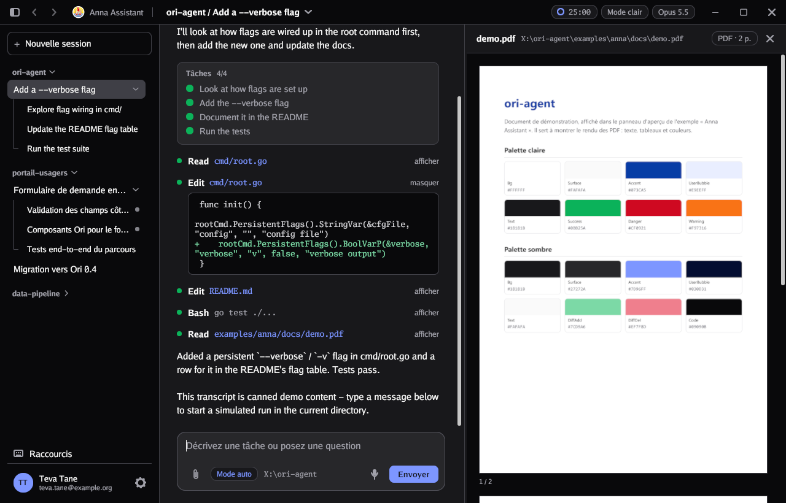
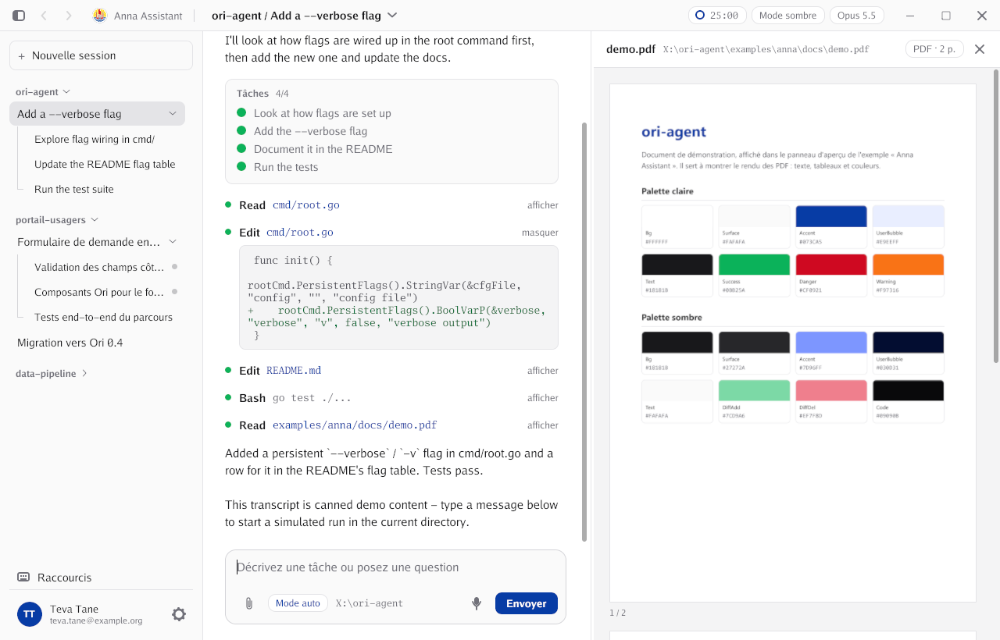
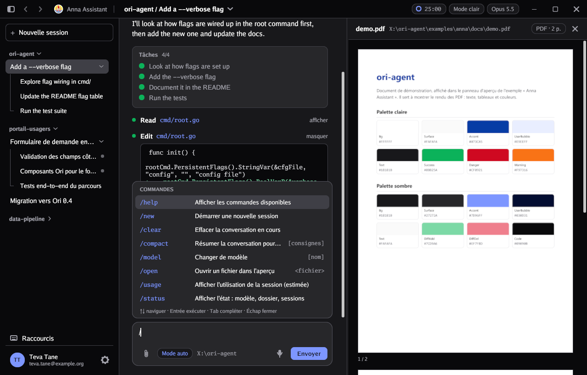

# ori-agent

[](https://github.com/sitle/ori-agent/actions/workflows/ci.yml)
[](https://pkg.go.dev/github.com/sitle/ori-agent)
[](LICENSE)

**ori-agent** est un framework Go pour créer des applications de bureau qui dialoguent avec un agent (un LLM, un assistant scripté, un moteur de règles…), dans le style de la vue « work » du client Claude Code. Vous écrivez l'agent, ori-agent fournit toute l'interface. Les couleurs suivent le design system [Ori](https://ori.gov.pf) des services publics de Polynésie française.



## Ce que vous obtenez

- Une fenêtre complète : barre de titre, arborescence projets → sessions → sous-agents, fil de conversation, zone de saisie.
- Un fil riche : réflexion du modèle en streaming, appels d'outils dépliables, listes de tâches, bouton Stop.
- Une palette de commandes `/`, extensible avec vos propres commandes.
- Un aperçu de documents à droite : Markdown, code, PDF et images.
- Des pièces jointes, une dictée vocale (moteur à brancher), un minuteur Pomodoro.
- Des pages Configuration et Profil, et vos propres pages.
- Une interface en français et en anglais, extensible à d'autres langues, avec changement en direct.
- Un thème clair et sombre, remplaçable par un autre design system.
- Windows, macOS et Linux, en Go pur sous Windows.

## Installation

Il faut Go 1.26 ou plus récent. Sous Linux et macOS, voir les [prérequis système](#plateformes).

```bash
go get github.com/sitle/ori-agent@latest
```

Pour voir le résultat tout de suite :

```bash
git clone https://github.com/sitle/ori-agent
cd ori-agent
go run ./examples/anna
```

## Démarrage en 20 lignes

```go
package main

import (
	"context"

	oriagent "github.com/sitle/ori-agent"
)

func main() {
	oriagent.Run(oriagent.Config{
		AppName: "Mon assistant",
		Agent: oriagent.AgentFunc(func(ctx context.Context, t *oriagent.Turn) error {
			b := t.Text()
			defer b.Done()
			b.Write("Vous avez écrit : " + t.Prompt)
			return nil
		}),
	})
}
```

L'agent reçoit chaque message dans un `Turn` et y écrit sa réponse. Le reste (fenêtre, sessions, commandes, aperçu, langues) est pris en charge.

## Documentation

| Guide | Pour… |
|---|---|
| [Prise en main](docs/prise-en-main.md) | Construire pas à pas sa première application : agent, commande, page, traductions |
| [Écrire un agent](docs/agents.md) | Brancher un LLM ou tout autre moteur : streaming, outils, tâches, sous-agents, annulation |
| [Personnaliser l'application](docs/personnalisation.md) | Toutes les options de `Config` : commandes, pages, modèles, profil, fonctionnalités |
| [Langues de l'interface](docs/langues.md) | Changer de langue, traduire ses textes, ajouter une langue |
| [Composants et thèmes](docs/composants.md) | Utiliser le kit `ui` seul, changer de design system, l'aperçu de documents |
| [Architecture](docs/architecture.md) | Comprendre le fonctionnement interne, avant de contribuer |
| [Référence de l'API](https://pkg.go.dev/github.com/sitle/ori-agent) | Les types et fonctions, avec des exemples |

Vous utilisez un assistant de code (Claude Code, Codex, Cursor…) ? Le dépôt fournit un [`llms.txt`](llms.txt) et une [skill prête à l'emploi](skills/ori-agent/SKILL.md) : voir [Utiliser ori-agent avec un assistant de code](docs/assistants-de-code.md).

## Exemples

- [`examples/minimal`](examples/minimal/main.go) : un agent « écho » d'une quarantaine de lignes.
- [`examples/anna`](examples/anna/main.go) : « Anna Assistant », la démonstration complète, avec un agent simulé, des données de démo, une page et des commandes en plus, des traductions.

```bash
go run ./examples/anna -lang en -light
```

Autres options : `-view setup -step 3`, `-view profile`, `-view shortcuts`, `-attach "fichier1,fichier2"`.

| | |
|---|---|
|  |  |
| Thème clair | Palette de commandes |

## Plateformes

- **Windows** : aucune dépendance native. Pour un exécutable sans console : `go build -ldflags=-H=windowsgui`.
- **macOS** : Xcode Command Line Tools (`xcode-select --install`).
- **Linux** (Debian, Ubuntu) :

  ```bash
  sudo apt install gcc pkg-config libwayland-dev libx11-dev libx11-xcb-dev libxkbcommon-x11-dev libgles2-mesa-dev libegl1-mesa-dev libffi-dev libxcursor-dev libvulkan-dev
  ```

L'intégration continue compile et teste sur les trois systèmes ; l'interface n'a été essayée à la main que sous Windows.

## Statut et limites

Le projet est expérimental (version 0.x) : l'API peut encore changer d'une version à l'autre, voir le [journal des modifications](CHANGELOG.md).

- Rien n'est persisté : sessions, réglages et profil vivent en mémoire.
- Fenêtre sans décoration native : sous macOS, les pastilles de fenêtre disparaissent.
- Pas de glisser-déposer de fichiers depuis le système (non pris en charge par Gio v0.8).
- Le Markdown de l'aperçu est un sous-ensemble : blocs seulement, sans gras ni liens cliquables.

## Contribuer

Les contributions sont les bienvenues : voir [CONTRIBUTING.md](CONTRIBUTING.md).

## Licence

Copyright © 2026 Leonard TAVAE et les contributeurs d'ori-agent.

Publié sous la licence [EUPL-1.2](LICENSE) (European Union Public Licence) : les versions modifiées et redistribuées doivent rester sous une licence compatible.

Le dépôt inclut des éléments tiers, qui restent sous leurs propres conditions :

- le logo de la Polynésie française (`examples/anna/assets/logo-pf.svg`), repris d'[ori.gov.pf](https://ori.gov.pf) pour l'exemple ;
- les couleurs du design system [Ori](https://ori.gov.pf) (paquet `theme`) ;
- les dépendances Go, dont [Gio](https://gioui.org) (MIT/Unlicense), [go-pdfium](https://github.com/klippa-app/go-pdfium) (MIT, avec PDFium sous BSD/Apache), [wazero](https://github.com/tetratelabs/wazero) (Apache-2.0), [zenity](https://github.com/ncruces/zenity) (MIT) et [oksvg](https://github.com/srwiley/oksvg) (BSD-3).
