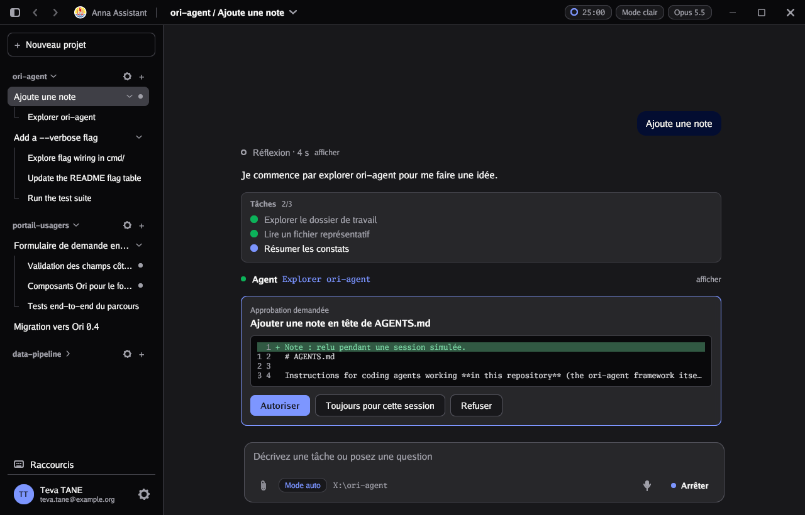
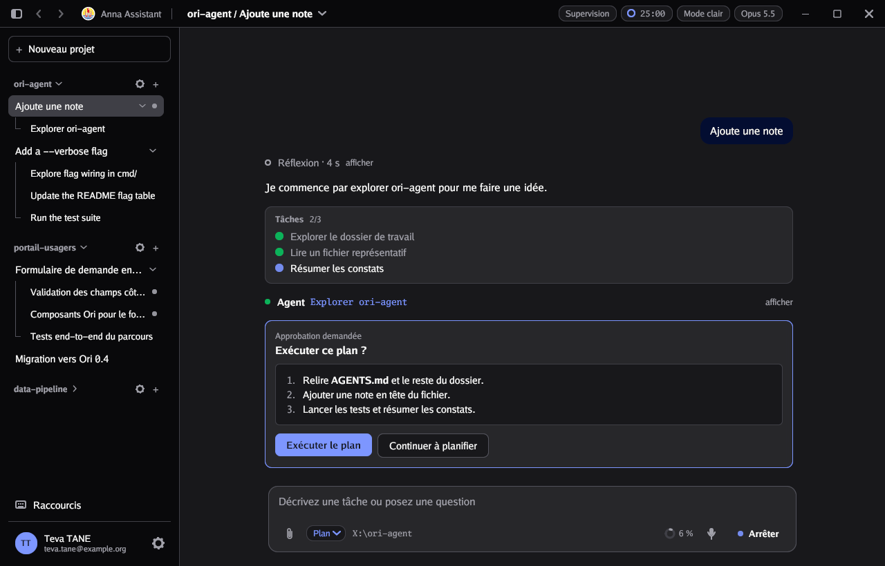
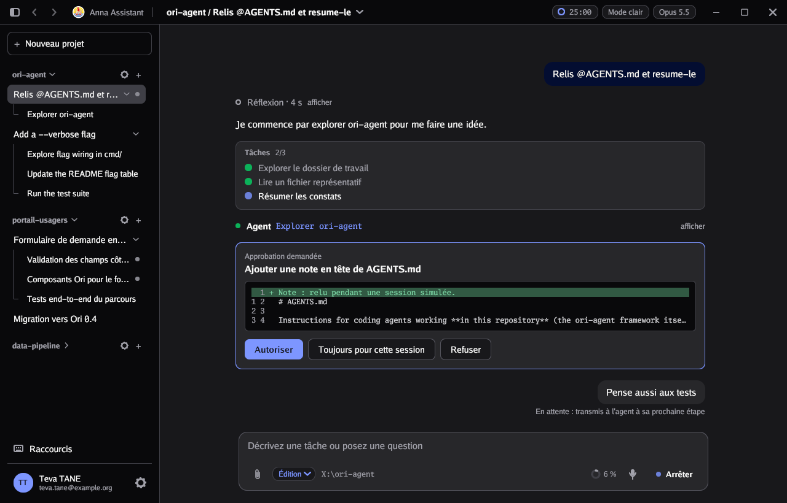

# Écrire un agent

L'agent est la partie que vous écrivez : il produit les réponses. ori-agent l'appelle à chaque message et affiche ce qu'il écrit.

## Le contrat

```go
type Agent interface {
	Run(ctx context.Context, t *oriagent.Turn) error
}
```

Une simple fonction suffit, grâce à `oriagent.AgentFunc(maFonction)`.

- `Run` est appelé dans **sa propre goroutine**, une fois par message envoyé. L'interface reste fluide pendant que l'agent travaille.
- Toutes les méthodes de `Turn` peuvent être appelées depuis n'importe quelle goroutine : ori-agent s'occupe des verrous et du rafraîchissement de l'écran.
- `Run` doit s'arrêter rapidement quand `ctx` est annulé (bouton Arrêter). ori-agent referme alors ce qui était en cours et affiche « Interrompu. ».
- Une erreur renvoyée par `Run` s'affiche en rouge dans le fil.

## Ce que l'agent reçoit

| Champ | Contenu |
|---|---|
| `t.Prompt` | Le message de l'utilisateur |
| `t.Attachments` | Les pièces jointes ; lire le fichier avec `Attachment.Path` |
| `t.History` | Les échanges précédents de la session (`Role` : `"user"` ou `"assistant"`, `Text`) |
| `t.Thinking` | `true` si la réflexion étendue est activée dans la Configuration |
| `t.AllowCommands`, `t.AskEdits` | Les autorisations (exécuter des commandes, demander avant de modifier un fichier) : celles du projet de la session s'il en a, sinon celles de la Configuration ; c'est à l'agent de les respecter |
| `t.Model` | Le modèle choisi par l'utilisateur (`Name`, `Desc`) |
| `t.WorkDir` | Le dossier de travail : celui du projet de la session s'il en a un, sinon celui de la Configuration |
| `t.Locale` | La langue de l'interface (`"fr"`, `"en"`…), pour répondre dans la même langue |
| `t.SessionID` | L'identifiant stable de la session (`Session.ID`), pour retrouver les enregistrements de l'agent d'un tour à l'autre ; un sous-agent a le sien |

## Ce que l'agent écrit

### Du texte en streaming

```go
b := t.Text()
b.Write("Bonjour ")
b.Write("le monde.")
b.Done()
```

### Une réflexion

Affichée pendant qu'elle s'écrit, puis repliée en « Réflexion · 3 s », que l'utilisateur peut rouvrir.

```go
if t.Thinking {
	th := t.Think()
	th.Write("Je dois d'abord lire le fichier de configuration…")
	th.Done()
}
```

### Des appels d'outils

Un appel s'affiche « en cours », puis devient dépliable avec sa sortie. Avec `File`, son argument devient un lien qui ouvre le fichier dans l'aperçu.

```go
call := t.Tool("Read", "config.yaml").File("/chemin/vers/config.yaml")
contenu, err := os.ReadFile("/chemin/vers/config.yaml")
if err != nil {
	call.Done(err.Error())
	return err
}
call.Done(string(contenu))
```

Les lignes de sortie qui commencent par `+` ou `-` sont colorées comme un diff.

Pour une modification de fichier, `Diff(ancien, nouveau)` affiche à la place de la sortie les lignes retirées et ajoutées, avec leurs numéros et trois lignes de contexte ; l'en-tête de l'appel donne le décompte « +3 -1 ».

```go
call := t.Tool("Edit", "main.go").File(chemin).Diff(avant, apres)
call.Done("")
```

### Demander une approbation

`Approve` affiche une carte dans le fil (titre, détail, diff éventuel) et attend la réponse de l'utilisateur : Autoriser, Toujours pour cette session (avec `AllowSession`) ou Refuser. C'est l'agent qui décide ce qui demande une approbation, par exemple selon `t.AskEdits`. La demande d'un sous-agent s'affiche dans la session principale ; une notification la signale si l'utilisateur regarde une autre session. Le bouton Arrêter retire la demande : `Approve` renvoie alors `Deny` et l'erreur de `ctx`.



```go
if t.AskEdits {
	d, err := t.Approve(ctx, oriagent.ApprovalRequest{
		Title: "Modifier main.go", Diff: true, Old: avant, New: apres, AllowSession: true,
	})
	if err != nil {
		return err
	}
	if d == oriagent.Deny {
		return nil // ne pas modifier
	}
	// d == oriagent.AllowSession : ne plus demander dans cette session (t.SessionID)
}
```

### Une liste de tâches

```go
taches := t.Tasks("Lire le code", "Corriger", "Lancer les tests") // la première démarre
taches.Advance(0)                      // 0 terminée, 1 démarre
taches.Set(2, oriagent.TaskDone)       // état explicite
```

### Des sous-agents

Un sous-agent est une session enfant : il apparaît sous la session dans la barre latérale, et comme un appel « Agent » cliquable dans le fil. Il s'écrit avec la même API qu'un tour normal.

```go
sous := t.Subagent("Explorer la doc", "Lis les fichiers Markdown et résume-les.")
sous.Tool("Glob", "**/*.md").Done("README.md\ndocs/guide.md")
sous.Finish("2 documents trouvés.") // devient la sortie de l'appel « Agent »
```

### Une notification

```go
t.Notify("Analyse terminée")
```

Les boutons peuvent porter d'autres libellés (`AllowLabel`, `DenyLabel`), et `Markdown: true` affiche `Detail` comme un texte mis en forme plutôt que comme du code, par exemple pour faire valider un plan :

```go
d, err := t.Approve(ctx, oriagent.ApprovalRequest{
	Title: "Exécuter ce plan ?", Detail: plan, Markdown: true,
	AllowLabel: "Exécuter le plan", DenyLabel: "Continuer à planifier",
})
```



### Le mode et le contexte

`t.Mode` est le mode choisi dans le badge de la zone de saisie au début du tour (voir « Modes de travail » dans la personnalisation) ; `t.SetMode(id)` le change, pour le badge et les tours suivants. `t.SetContext(utilises, fenetre)` remplit la jauge de contexte de la zone de saisie, en jetons : l'agent l'appelle après chaque réponse du modèle ; une fenêtre de 0 masque la jauge. L'application restaure la jauge avec la session (`Session.ContextUsed`, `ContextWindow`).

### Quand rien ne s'écrit

Tant que le tour tourne sans que rien ne bouge (aucun bloc de texte ou de réflexion ouvert, aucun outil en cours, aucune approbation en attente), le fil montre « <AppName> réfléchit… », avec le temps écoulé. L'agent n'a rien à faire pour cela ; ouvrir un bloc ou un appel d'outil remplace cette ligne.

### Les messages envoyés pendant le tour

Pendant que l'agent travaille, l'utilisateur peut écrire : son message s'affiche « En attente ». `t.TakeMessages()` rend ces messages (texte et pièces jointes) et les marque comme transmis ; l'agent l'appelle typiquement avant chaque nouvel appel au modèle, et les ajoute à la conversation. Ceux qu'il ne prend pas lancent un nouveau tour quand le sien se termine ; un sous-agent n'en reçoit pas.

```go
for _, q := range t.TakeMessages() {
	conversation = append(conversation, messageUtilisateur(q.Text, q.Attachments))
}
```

Si l'utilisateur arrête le tour, ses messages en attente reviennent dans la zone de saisie, pièces jointes comprises. L'agent simulé (`sim`) les prend avant sa réponse finale.



### Mettre à jour le profil et les modèles

Un tour de connexion (lancé par une commande `/login` avec `c.RunTurn`) peut remplacer ce qui a été fixé au démarrage :

```go
t.SetUser(oriagent.User{First: "Hina", Email: "hina@exemple.pf"})
t.SetModels(modelesAutorises) // le modèle choisi reste sélectionné s'il existe encore
```

## Brancher un vrai LLM

La plupart des API de LLM renvoient un flux d'événements : morceaux de texte, morceaux de réflexion, demandes d'outil, fin de réponse. Il suffit de traduire chaque événement vers le `Turn`. Voici la structure, avec un client imaginaire `llm` à remplacer par celui de votre fournisseur :

```go
func (a *MonAgent) Run(ctx context.Context, t *oriagent.Turn) error {
	messages := toMessages(t.History, t.Prompt) // votre conversion

	for {
		stream, err := a.client.Stream(ctx, llm.Request{
			Model:    t.Model.Name,
			Messages: messages,
			Thinking: t.Thinking,
			Tools:    a.tools,
		})
		if err != nil {
			return err
		}

		var text, thought *oriagent.Block
		var toolCalls []llm.ToolCall
		for ev := range stream.Events() {
			switch ev.Type {
			case "thinking_delta":
				if thought == nil {
					thought = t.Think()
				}
				thought.Write(ev.Text)
			case "text_delta":
				if thought != nil {
					thought.Done()
					thought = nil
				}
				if text == nil {
					text = t.Text()
				}
				text.Write(ev.Text)
			case "tool_use":
				toolCalls = append(toolCalls, ev.ToolCall)
			}
		}
		if text != nil {
			text.Done()
		}
		if err := stream.Err(); err != nil {
			return err // inclut l'annulation : ctx est transmis au client
		}
		if len(toolCalls) == 0 {
			return nil // réponse finale
		}

		// Exécuter les outils demandés, les afficher, renvoyer les résultats.
		for _, tc := range toolCalls {
			call := t.Tool(tc.Name, tc.Summary())
			result := a.execute(ctx, tc)
			call.Done(result)
			messages = append(messages, llm.ToolResult(tc.ID, result))
		}
	}
}
```

Points d'attention :

- **Transmettez `ctx` au client HTTP** : le bouton Arrêter annule alors la requête en cours.
- **Ne gardez pas d'état global** entre deux tours : tout ce dont l'agent a besoin est dans le `Turn`, ou dans votre structure d'agent.
- **Une session à la fois** : un nouveau message est refusé tant que le tour en cours n'est pas terminé dans cette session ; d'autres sessions peuvent travailler en parallèle.

## Lancer un tour depuis une commande

Une commande peut démarrer un tour avec une fonction de votre choix, par exemple une revue de code :

```go
revue := &oriagent.Command{
	Name: "revue",
	Desc: "Relire le code",
	Run: func(c *oriagent.Ctl, _ string) string {
		if err := c.RunTurn("", monAgent.Revue); err != nil {
			return err.Error()
		}
		return "Revue lancée."
	},
}
```

`RunTurn(prompt, nil)` utilise l'agent configuré.

## Faire tourner un agent sans fenêtre

`NewHeadless` fait tourner l'agent de la configuration sans ouvrir de fenêtre, par le même `Turn` que l'application : pour des tests, des bancs d'évaluation ou des scripts. `Run` lance un tour dans une session (nouvelle si `nil`, ou existante pour enchaîner les tours avec l'historique), attend la fin et renvoie la session, dont le fil se lit dans `Session.Messages`. Les réglages que la fenêtre prend dans la Configuration se donnent dans `TurnOptions`.

```go
h := oriagent.NewHeadless(oriagent.Config{Agent: monAgent})
h.Approve = func(r oriagent.ApprovalRequest) oriagent.Decision {
	return oriagent.Allow // nil : toutes les demandes sont refusées
}
s, err := h.Run(ctx, nil, "Corrige le test", nil, oriagent.TurnOptions{WorkDir: dossier, AskEdits: true})
if err != nil {
	return err
}
for _, m := range s.Messages {
	fmt.Println(m.Kind, m.Text, m.ToolName, m.Output)
}
```

`Approve` répond aux demandes d'approbation de l'agent, dans la goroutine de l'agent ; une demande reste visible dans le fil avec sa réponse. Un second `Run` dans une session encore occupée renvoie `ErrSessionBusy`. `h.Send(s, texte)` ajoute un message pendant le tour, comme si l'utilisateur l'écrivait ; s'il n'est pas pris par `TakeMessages` avant la fin du tour, il est retiré du fil. Le test [`sim/sim_test.go`](../sim/sim_test.go) teste ainsi l'agent simulé.

## S'inspirer de l'agent simulé

Le paquet [`sim`](../sim/sim.go) est un agent complet sans modèle : réflexion, liste de tâches, sous-agent qui explore le dossier, modification proposée avec son diff et approbation, lecture des pièces jointes, commandes `/review` et `/init`, réponses bilingues. C'est le meilleur point de départ pour structurer le vôtre.
