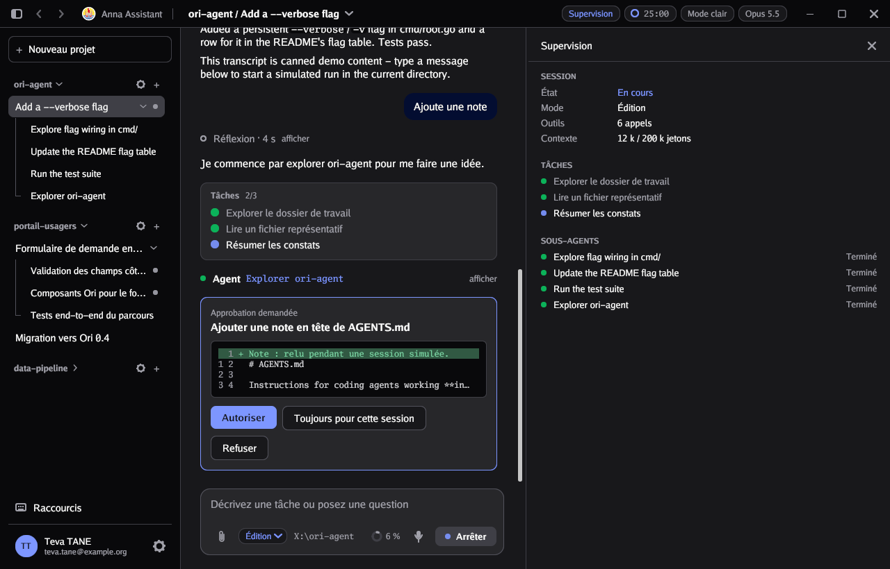
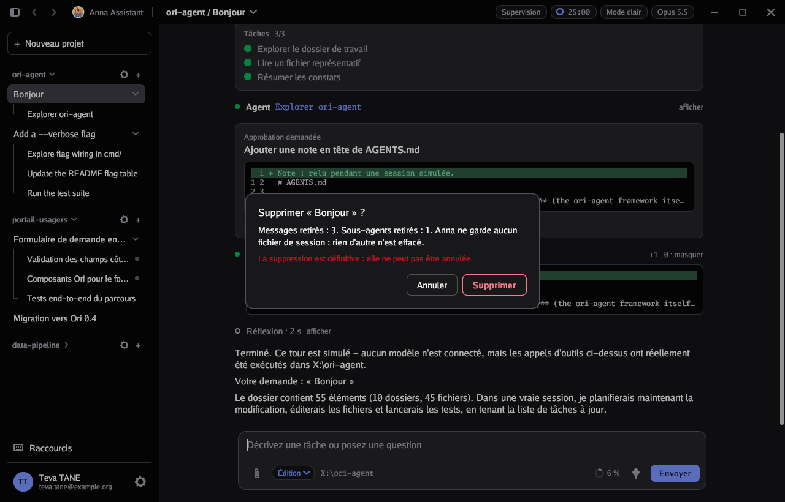
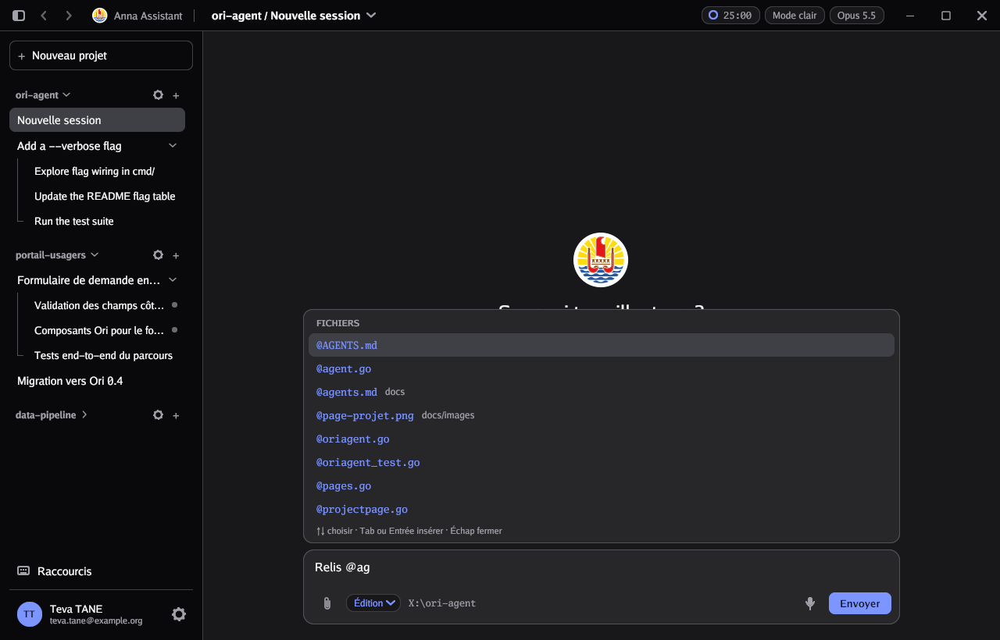
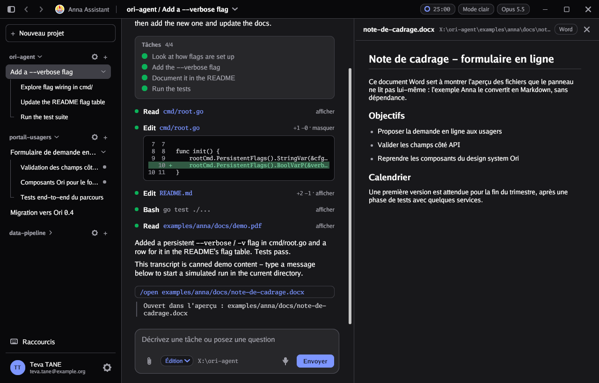
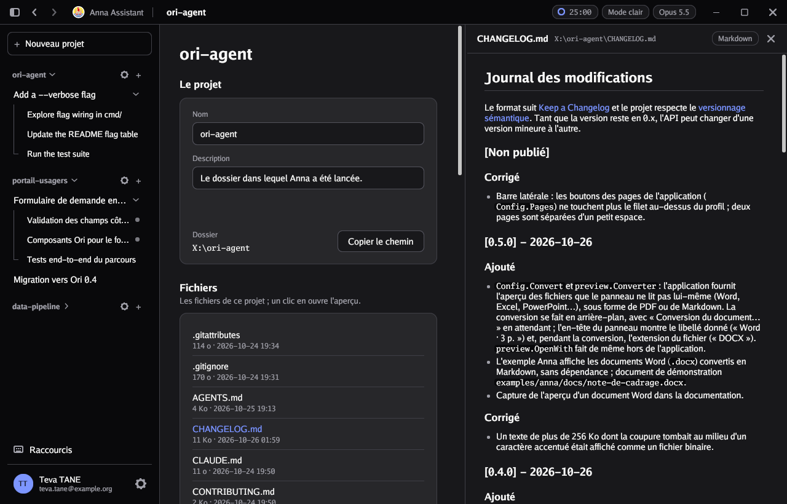

# Personnaliser l'application

Tout se règle dans la structure `oriagent.Config` passée à `oriagent.Run`. Tous les champs sont facultatifs : une `Config` vide donne déjà une application complète.

## Identité et apparence

| Champ | Rôle | Par défaut |
|---|---|---|
| `AppName` | Nom affiché dans la barre de titre et l'écran d'accueil | `"Assistant"` |
| `WindowTitle` | Titre de la fenêtre pour le système | `AppName` |
| `Logo` | Logo SVG (`[]byte`, souvent via `//go:embed`) | un rond de couleur |
| `Light`, `Dark` | Palettes de couleurs (voir [Composants et thèmes](composants.md)) | Ori |
| `Fonts` | Polices (`[]font.FontFace`) | polices Go intégrées |
| `LightMode` | Démarrer en thème clair | thème sombre |
| `Width`, `Height` | Taille initiale de la fenêtre | 1280 × 820 |
| `Placeholder` | Texte d'invite de la zone de saisie | « Décrivez une tâche… » |
| `ModeLabel` | Badge de la zone de saisie (`"-"` le masque), quand l'application ne donne pas de `Modes` | « Mode auto » |
| `EmptyTitle`, `EmptySubtitle` | Écran d'une session vide | « Sur quoi travaille-t-on ? », dossier de travail |

Les textes peuvent être des clés de traduction (voir [Langues](langues.md)).

## Agent, modèles et dossier

| Champ | Rôle |
|---|---|
| `Agent` | Le moteur qui répond (voir [Écrire un agent](agents.md)) |
| `Models` | Les modèles proposés dans la Configuration, par `/model` et dans la barre de titre. `Desc` peut être une clé de traduction |
| `WorkDir` | Dossier de travail ; par défaut, le dossier courant. L'utilisateur peut le changer dans la Configuration |

## Mémoriser les réglages

ori-agent n'enregistre rien lui-même. La structure `oriagent.Settings` réunit toutes les valeurs de la page Configuration, et l'application les conserve où elle veut :

| Champ | Valeur |
|---|---|
| `WorkDir` | Dossier de travail |
| `AllowCommands`, `AskEdits` | Autoriser les commandes, demander avant de modifier un fichier |
| `Thinking` | Réflexion étendue |
| `Notifications` | Notifications |
| `Model` | Le `Name` du modèle choisi |
| `Dark` | Thème sombre |
| `Locale` | Langue de l'interface |

- `Config.Settings` donne les valeurs de départ. Il prime sur `WorkDir`, `LightMode` et `Locale` ; un dossier qui n'existe plus, une langue sans catalogue ou un modèle inconnu sont ignorés. Sans lui, ce sont les valeurs de `oriagent.DefaultSettings()` : commandes, confirmation des modifications, réflexion et thème sombre activés.
- `Config.OnSettings` reçoit les nouvelles valeurs à chaque changement : interrupteurs et choix de la Configuration, bouton de thème de la barre de titre, `/model`, `/theme`, `/lang`, `c.SetThinking`, dossier appliqué par « Terminer ». Il est appelé à la fin de l'image, dans le fil de l'interface, état verrouillé : il doit rendre la main vite, donc écrire le fichier dans une goroutine.
- Une commande lit les valeurs courantes avec `c.Settings()` ; un agent avec `t.Thinking`, `t.AllowCommands`, `t.AskEdits`, `t.Model`, `t.WorkDir` et `t.Locale`.

`Settings` porte des étiquettes JSON :

```go
set := oriagent.DefaultSettings()
if data, err := os.ReadFile(chemin); err == nil {
	_ = json.Unmarshal(data, &set) // les champs absents gardent leur valeur par défaut
}
oriagent.Run(oriagent.Config{
	Settings: &set,
	OnSettings: func(s oriagent.Settings) {
		data, _ := json.MarshalIndent(s, "", "  ")
		go os.WriteFile(chemin, data, 0o600)
	},
})
```

## Commandes

Chaque commande est un `*oriagent.Command` :

```go
&oriagent.Command{
	Name: "export",          // tapée /export
	Args: "<fichier>",       // aide affichée dans la palette
	Desc: "Exporter la conversation",
	Run:  func(c *oriagent.Ctl, args string) string { /* … */ return "Exporté." },
}
```

- `Args` entre chevrons (`<x>`) indique un argument obligatoire : choisir la commande dans la palette la complète au lieu de l'exécuter. Entre crochets (`[x]`), l'argument est facultatif.
- Le texte renvoyé par `Run` s'affiche dans le fil ; une chaîne vide n'affiche rien.
- `Run` s'exécute dans le fil de l'interface : les traitements longs passent par `c.RunTurn` ou par une goroutine.

Ce que `Ctl` permet :

| Méthode | Effet |
|---|---|
| `Session()`, `Sessions()`, `Projects()` | Accéder aux sessions |
| `NewSession()`, `Clear()` | Nouvelle session, effacer la conversation |
| `RunTurn(prompt, fn)` | Lancer un tour d'agent (`fn` nil : l'agent configuré) |
| `Open(chemin)` | Ouvrir un fichier dans l'aperçu |
| `PickFiles()` | Ouvrir le sélecteur de pièces jointes |
| `Notify(msg)` | Notification passagère |
| `Show(vue)` | Afficher `"chat"`, `"setup"`, `"profile"` ou l'`ID` d'une page |
| `Models()`, `Model()`, `SetModel(i)`, `SetModels(ms)` | Modèle actif, liste des modèles |
| `User()`, `SetUser(u)` | Profil (voir [Profil](#profil)) |
| `Dark()`, `SetDark(b)` | Thème |
| `Settings()` | Valeurs de la page Configuration (voir [Mémoriser les réglages](#mémoriser-les-réglages)) |
| `SetThinking(b)` | Raisonnement étendu des tours suivants, comme l'interrupteur de la page Configuration |
| `Locale()`, `Locales()`, `SetLocale(l)`, `LanguageName(l)`, `T(clé)` | Langue et traductions |
| `ToggleSidebar()`, `ToggleVoice()`, `Pomodoro()` | Barre latérale, dictée, minuteur |
| `WorkDir()`, `Commands()` | Dossier de travail, liste des commandes |

Commandes intégrées : `/help`, `/new`, `/clear`, `/compact`, `/model`, `/open`, `/usage`, `/status`, `/lang`, `/sidebar`, `/upload`, `/voice`, `/pomodoro`, `/theme`, `/config`, `/profile`. Elles disparaissent avec `Disable.BuiltinCommands`, ou individuellement quand la fonctionnalité correspondante est désactivée.

## Pages

```go
oriagent.Page{
	ID:     "stats",                   // utilisé par Ctl.Show et StartView
	Title:  "Statistiques",            // ou une clé de traduction
	Icon:   monIcone,                  // facultatif : func(gtx, couleur) layout.Dimensions
	Layout: func(gtx layout.Context, th *ui.Theme, tr i18n.Translator) layout.Dimensions {
		return th.Section(gtx, tr.T("stats.titre"), "", contenu)
	},
}
```

Les pages s'affichent dans la barre latérale, au-dessus du profil. Le kit [`ui`](composants.md) fournit sections, panneaux, champs, interrupteurs, boutons, cartes de choix… L'exemple `examples/anna` contient une page « Raccourcis » complète.

## Profil

| Champ | Rôle |
|---|---|
| `User` | Prénom, nom, e-mail, service et fonction (`First`, `Last`, `Email`, `Service`, `Role`) |
| `Devices` | Appareils connectés (`Name`, `Detail`, `Current`) ; vide, la section est masquée |
| `ProfileLock` | Champs en lecture seule (`First`, `Last`, `Email`, `Service`, `Role`), par exemple ceux qui viennent d'un annuaire |
| `OnProfile` | Appelé avec les champs modifiés quand l'utilisateur clique sur « Enregistrer » |
| `OnLogout` | Appelé par le bouton « Se déconnecter » |

Sans `OnProfile`, les modifications restent en mémoire, et sans `OnLogout` la déconnexion est simulée. Les deux fonctions s'exécutent dans une goroutine : pendant ce temps les boutons de la page sont inactifs et affichent « Enregistrement… » ou « Déconnexion… ». Le `User` renvoyé par `OnProfile` remplace les champs et le pied de la barre latérale ; l'application peut le corriger, par exemple remettre une adresse qu'elle ne laisse pas modifier. Une erreur s'affiche dans une notification et les modifications restent dans les champs.

```go
oriagent.Config{
	User:        utilisateur,
	ProfileLock: oriagent.ProfileLock{Email: true},
	OnProfile: func(ctx context.Context, u oriagent.User) (oriagent.User, error) {
		return annuaire.Enregistrer(ctx, u) // renvoie le profil tel qu'enregistré
	},
	OnLogout: func(ctx context.Context) error { return session.Fermer(ctx) },
}
```

Le profil et les modèles fixés au démarrage peuvent changer ensuite, par exemple après une connexion : `c.SetUser(u)` et `c.SetModels(ms)` dans une commande, `t.SetUser(u)` et `t.SetModels(ms)` depuis un tour d'agent (lancé par `c.RunTurn`). Le modèle choisi reste sélectionné si son nom figure encore dans la liste, sinon c'est le premier ; `OnSettings` est appelé si la sélection change.

## Modes de travail

`Modes` transforme le badge de la zone de saisie en menu de modes : l'application les définit et décide de ce qu'ils permettent (par exemple « Plan », « Lecture », « Édition », « Auto »).

```go
Modes: []oriagent.Mode{
	{ID: "plan", Label: "mode.plan", Desc: "mode.plan.desc"},
	{ID: "edition", Label: "mode.edition", Desc: "mode.edition.desc"},
},
OnMode: func(ctx context.Context, p *oriagent.Project, mode string) error {
	return enregistrerLeMode(p, mode) // p nil : les sessions hors projet
},
```

- Le mode appartient au projet de la session (`Project.Mode`, à remplir au démarrage), ou à l'application pour les sessions hors projet ; le premier mode de la liste sert par défaut.
- Le choix de l'utilisateur s'applique tout de suite, puis `OnMode` est appelé dans une goroutine ; une erreur remet le mode précédent et s'affiche.
- L'agent lit le mode du tour dans `Turn.Mode`, et peut le changer lui-même avec `t.SetMode` (par exemple quand l'utilisateur approuve un plan) ; une commande le change avec `c.SetMode`, et le lit avec `c.Mode()`. Ni l'un ni l'autre n'appelle `OnMode`.
- Un mode qui n'aboutit pas dans `OnMode` alors que l'utilisateur en a déjà choisi un autre ne remet pas l'ancien : le dernier choix est gardé.

L'agent simulé fournit ses propres modes, `sim.Modes` : « Édition » (demande avant de modifier, selon les autorisations), « Plan » (un plan à valider, puis passage en Édition) et « Auto » (modifie sans demander). L'exemple Anna les utilise et garde le mode de chaque projet créé dans son `project.json` (`OnMode`).

## Panneaux

`Panels` ajoute des panneaux à droite du fil, chacun ouvert et fermé par son bouton dans la barre de titre (ou `c.TogglePanel(id)` depuis une commande) : une supervision des agents, un résumé du travail, des indicateurs… `Layout` dessine le contenu pour la session affichée, dans une colonne défilante que le canevas coiffe du titre et d'un bouton de fermeture.

```go
Panels: []oriagent.Panel{{
	ID: "supervision", Title: "sup.title",
	Layout: func(gtx layout.Context, th *ui.Theme, tr i18n.Translator, s *oriagent.Session) layout.Dimensions {
		return dessinerEtat(gtx, th, monAgent.Etat(s.ID))
	},
}},
```

- Un panneau ouvert prend la place de l'aperçu ; ouvrir un fichier dans l'aperçu ferme le panneau.
- `Layout` est appelé à chaque image, et deux fois par seconde tant qu'un tour tourne dans la session (ou l'un de ses sous-agents) : il peut montrer un état qui change sans que l'agent écrive dans le fil. Il doit rester rapide et lire un état déjà calculé.
- La session reçue est celle affichée, qui peut être celle d'un sous-agent : `s.Parent()` remonte à la session principale.
- `c.TogglePanel` avec un identifiant inconnu, ou un panneau sans `Layout`, ne fait rien.

L'exemple Anna ([`examples/anna/supervision.go`](../examples/anna/supervision.go)) ajoute un panneau « Supervision » construit uniquement avec l'API publique : état de la session, mode, nombre d'appels d'outils, contexte, liste de tâches en cours et sous-agents.



## Supprimer une session

Sans `OnDeleteSession`, une session peut seulement être archivée (retirée de la barre latérale). Avec, le menu de la session propose « Supprimer la session… » et une corbeille apparaît au survol de la session dans la barre latérale ; une boîte demande confirmation, avec ce que l'application dit qu'elle perdra (`DeleteSessionInfo`).

```go
OnDeleteSession: func(ctx context.Context, s *oriagent.Session) error {
	return monAgent.Supprimer(s.ID) // dossier, historique…
},
DeleteSessionInfo: func(s *oriagent.Session) string {
	return "Le dossier " + dossierDe(s) + " sera supprimé."
},
```

- La suppression tourne dans une goroutine ; si elle échoue, l'erreur s'affiche et la session reste.
- Une session dont un tour tourne, ou celle d'un sous-agent, ne propose pas la suppression.
- Pendant la suppression, aucun tour ne peut partir dans la session ; si un tour a démarré derrière la boîte (Entrée dans la zone de saisie), la confirmation est refusée.

L'exemple Anna ([`examples/anna/store.go`](../examples/anna/store.go)) ne garde aucun fichier de session : sa suppression ne fait que prendre un peu de temps, et `DeleteSessionInfo` dit, dans la langue de l'interface, combien de messages et de sous-agents seront retirés.



## Revenir à un message

Avec `OnRewind`, chaque message de l'utilisateur montre « ↶ Revenir ici » au survol, hors tour en cours. Après confirmation, la fonction reçoit la session et le rang du message parmi ceux de l'utilisateur (0 pour le premier) ; l'application y rétablit son propre état (fichiers modifiés, historique de l'agent). Si elle réussit, le fil est coupé avant ce message et son texte revient dans la zone de saisie, prêt à être modifié ; sinon l'erreur s'affiche et rien ne change.

```go
OnRewind: func(ctx context.Context, s *oriagent.Session, n int) error {
	return monAgent.Revenir(s.ID, n)
},
```

Pendant le retour, aucun nouveau tour ne peut partir dans la session. Les sous-agents lancés après ce message disparaissent avec lui, et ses pièces jointes reviennent avec son texte. L'exemple Anna n'a rien à rétablir : son agent simulé n'écrit aucun fichier.

## Mentionner un fichier

Avec `Mentions`, taper « @ » suivi d'un mot dans la zone de saisie ouvre une liste de suggestions, au-dessus de la zone de saisie. La fonction est appelée une fois par requête (le mot après « @ ») et doit répondre vite ; elle rend au plus 8 `Mention` utiles : `Label` (le nom affiché), `Detail` (le dossier, en gris) et `Insert` (le texte inséré après « @ »). Flèches pour choisir, Tab ou Entrée pour insérer, Échap pour fermer. Une adresse comme `nom@exemple.pf` n'ouvre pas la liste. C'est à l'agent de lire ensuite les fichiers mentionnés dans le message. Échap ferme la liste sans toucher au texte ; elle se rouvre si l'on continue à taper. Le bouton Envoyer envoie le message tel qu'il est écrit.

L'exemple Anna ([`examples/anna/mentions.go`](../examples/anna/mentions.go)) propose les fichiers du dossier de la session, sur trois niveaux, ceux dont le nom commence par la requête en premier.



## Projets

Un projet regroupe des sessions dans la barre latérale. En plus de son nom et de ses sessions, il peut avoir :

| Champ | Rôle |
|---|---|
| `Description` | Un texte libre, modifiable par l'utilisateur (ce n'est pas une clé de traduction) |
| `WorkDir` | Son dossier : il devient `Turn.WorkDir` pour ses sessions et leurs sous-agents, et c'est lui qui est affiché, copié et proposé pour joindre un fichier. Vide : le dossier de la Configuration |
| `Permissions` | Ses autorisations (`AllowCommands`, `AskEdits`), transmises à l'agent à la place de celles de la Configuration. Nil : celles de la Configuration |
| `Mode` | Son mode de travail, parmi `Config.Modes` (voir « Modes de travail ») |
| `Permanent` | Pas de bouton de suppression sur sa page (par exemple le dossier où l'application a été lancée) |

Chaque ligne de projet porte un « + » qui démarre une session dedans, ou reprend sa session vide ; `c.NewSessionIn(p)` fait de même depuis une commande.

Trois rappels laissent l'application gérer les projets :

- **`OnNewProject(ctx, nom, description)`** : le bouton principal de la barre latérale devient « Nouveau projet » et ouvre un formulaire. L'application crée ce qui porte le projet, souvent un dossier, et renvoie le `*Project`.
- **`OnUpdateProject(ctx, projet, modif)`** : une roue dentée sur chaque ligne de projet ouvre sa page (nom, description, autorisations, dossier copiable). L'application enregistre la modification et la renvoie telle qu'elle l'a gardée.
- **`OnDeleteProject(ctx, projet)`** : ajoute à cette page un bouton de suppression, à confirmer, sauf pour un projet `Permanent`.

Ils s'exécutent dans une goroutine ; une erreur reste affichée dans le formulaire ou la page.

**`ProjectFiles(projet)`** ajoute à la page d'un projet une section « Fichiers » : l'application renvoie une liste de `ProjectFile` (`Name`, `Detail` pour la taille, la date ou une empreinte, `Path`, `Warning` affiché en rouge). Un clic sur un fichier dont `Path` est renseigné l'ouvre dans l'aperçu, à côté de la page. La liste est demandée dans une goroutine à chaque ouverture de la page ; un message d'attente s'affiche en attendant.

**`Convert`** fournit l'aperçu des fichiers que le panneau ne lit pas lui-même : documents Word, Excel, PowerPoint, ou tout autre format binaire. La fonction reçoit le chemin et rend un `preview.Converted` : `PDF` (les octets d'un PDF, affiché page par page comme un PDF ordinaire) ou `Markdown` (affiché comme un fichier Markdown), avec un `Label` pour l'en-tête du panneau (« Word »). Elle tourne dans une goroutine, « Conversion du document… » s'affiche en attendant ; une erreur est affichée dans le panneau, et `nil` laisse le fichier affiché comme binaire. Les textes, images et PDF ne passent jamais par elle.

L'exemple Anna ([`examples/anna/convert.go`](../examples/anna/convert.go)) convertit ainsi les documents Word (`.docx`) en Markdown, en lisant leur XML, sans dépendance : titres, listes et paragraphes. Pour les autres formats, une application peut passer par LibreOffice (`soffice --headless --convert-to pdf`) et rendre le PDF obtenu. Essayez avec `/open examples/anna/docs/note-de-cadrage.docx`.





Pour tous ces rappels, l'exemple [`examples/anna/store.go`](../examples/anna/store.go) en donne une version complète : un dossier par projet, marqué par un fichier `project.json`, rechargé au démarrage, et une suppression qui ne touche jamais un dossier que l'application n'a pas créé.

## Données de démonstration

`Projects` remplit l'arborescence au démarrage. Des constructeurs facilitent l'écriture des transcripts :

```go
s := &oriagent.Session{Title: "Corriger la connexion", Messages: []*oriagent.Message{
	oriagent.UserMsg("Le bouton de connexion ne fait rien."),
	oriagent.ThinkingMsg("Le gestionnaire de clic n'est sans doute pas branché.", 3),
	oriagent.TasksMsg(oriagent.Task{Text: "Lire le code", Status: oriagent.TaskDone}),
	oriagent.ToolMsg("Read", "login.go", "   1  package main"),
	oriagent.TextMsg("Corrigé : le gestionnaire est maintenant enregistré."),
}}
s.Spawn("Lancer les tests") // un sous-agent

Projects: []*oriagent.Project{oriagent.NewProject("site-web", s)},
```

Mettez `Expanded: true` sur un message d'outil pour l'afficher déplié, `HasDiff: true` avec `DiffOld` et `DiffNew` pour qu'il montre une modification sous forme de diff, `ID` sur une session restaurée pour que l'agent la reconnaisse (`Turn.SessionID` ; ori-agent en donne un aux autres, voir `NewSessionID`), `Busy: true` sur une session pour l'indicateur d'activité, `Open: false` sur un projet pour le replier.

## Fonctionnalités

`Disable` désactive des parties intégrées ; par défaut, tout est actif.

```go
Disable: oriagent.Features{
	Voice:           true, // bouton micro et /voice
	Pomodoro:        true, // minuteur de la barre de titre
	Attachments:     true, // trombone et /upload
	Preview:         true, // panneau d'aperçu
	Setup:           true, // page Configuration (engrenage)
	Profile:         true, // page Profil
	ThemeToggle:     true, // bouton de thème et /theme
	BuiltinCommands: true, // toutes les commandes intégrées
},
```

## Dictée vocale

La dictée fournie est simulée. Pour un vrai moteur de reconnaissance vocale, implémentez :

```go
type Dictation interface {
	Start() error           // commencer la capture
	Stop() (string, error)  // arrêter et renvoyer le texte (peut bloquer)
}
```

En option, `Level() float32` (interface `Leveler`) anime l'onde avec le vrai niveau sonore, et `SetLocale(string)` (interface `LocaleSetter`) suit la langue de l'interface.

## Pomodoro

`Pomodoro: oriagent.PomodoroConfig{Focus: 50 * time.Minute, Short: 10 * time.Minute, Long: 30 * time.Minute}` change les durées (25, 5 et 15 minutes par défaut).

## État au démarrage

Utile pour les démonstrations et les tests :

| Champ | Effet |
|---|---|
| `StartView` | Vue affichée : `"chat"`, `"setup"`, `"profile"` ou l'`ID` d'une page |
| `SetupStep` | Étape de la Configuration (1 à 4) avec `StartView: "setup"` |
| `Attach` | Fichiers joints à la zone de saisie |
| `Preview` | Fichier ouvert dans l'aperçu |
| `Locale`, `LightMode` | Langue et thème |
| `Settings` | Tous les réglages de la Configuration (voir [Mémoriser les réglages](#mémoriser-les-réglages)) |
